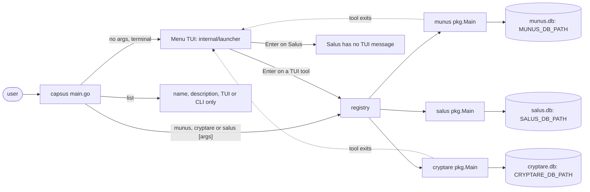
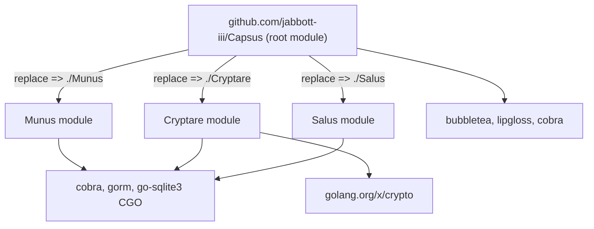

# Repository Map

Capsus has no Go code yet. The tree below marks what exists today and what Plan 1
(`intel/plan.md`) adds; update it as each phase lands (P-043).

```
Capsus/
├── main.go                  # planned (P-021): version stamp, cobra root `capsus` (list, munus, cryptare, salus, --vim)
├── internal/launcher/       # planned (P-022): tool registry (name, description, has-TUI, version, Main) + Bubble Tea menu
├── go.mod, go.sum           # planned (P-020): module github.com/jabbott-iii/Capsus; require + replace the three tools
├── Munus/                   # planned (P-010): git subtree of jabbott-iii/Munus (own go.mod, AGENTS.md, intel/)
├── Cryptare/                # planned (P-010): git subtree of jabbott-iii/Cryptare
├── Salus/                   # planned (P-010): git subtree of jabbott-iii/Salus
├── Dockerfile               # planned (P-030): `static` stage builds the musl static Linux release binary
├── tools/licenses/          # planned (P-040): THIRD_PARTY_LICENSES generator for the combined binary
├── scripts/smoke.sh         # smoke test of a built capsus binary (Makefile `smoke`, ci.yml, cd.yml)
├── Makefile                 # per-module checks, build, smoke, security scans, `tool` delegation, release tagging
├── .github/workflows/       # ci.yml (layout, per-module tests, smoke), security.yml (CodeQL, gosec, govulncheck),
│                            # docker.yml (static Linux binary), cd.yml (release archives + provenance)
├── .github/dependabot.yml   # weekly grouped updates: actions, root Go module (direct deps), Docker base images
├── .github/pull_request_template.md
├── intel/                   # maintainer knowledge base: plan, maint, map, cybersec, notes, history, golang
└── AGENTS.md, README.md, CONTRIBUTING.md, CODE_OF_CONDUCT.md, LICENSE, NOTICE.txt, CODEOWNERS.txt
```

## Planned runtime flow



## Module dependencies (planned)


